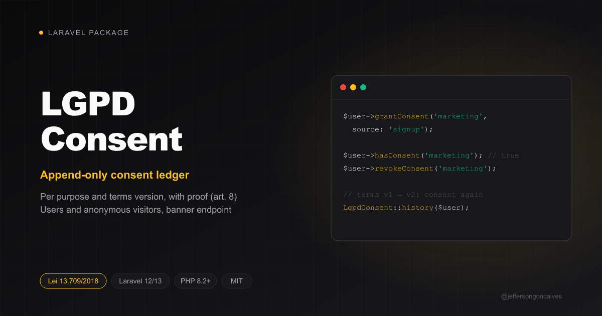

# Laravel LGPD Consent



[](https://packagist.org/packages/jeffersongoncalves/laravel-lgpd-consent)
[](https://github.com/jeffersongoncalves/laravel-lgpd-consent/actions/workflows/tests.yml)
[](https://packagist.org/packages/jeffersongoncalves/laravel-lgpd-consent)

Consent ledger for the Brazilian General Data Protection Law (LGPD, Lei 13.709/2018). It is part of the [laravel-lgpd](https://github.com/jeffersongoncalves/laravel-lgpd) suite.

Under the LGPD the controller must prove that consent was given (art. 8, §2), and consent can be revoked at any time (art. 8, §5). This package records every decision as a new row, and never updates or deletes a row:

- grants and revocations per **purpose**, with the **terms version** in force at the time;
- proof of consent: IP address, user agent, source, and custom metadata;
- when you bump a purpose's terms version, consents given under the old version stop counting;
- consents can expire after a period you configure;
- works for users (any Eloquent model) and for anonymous visitors (a random id stored in a cookie);
- an optional endpoint where your cookie banner can record each choice.

> This package gives you tooling. It does not make you compliant on its own. You still need legal review for your purposes and terms.

## Installation

```bash
composer require jeffersongoncalves/laravel-lgpd-consent
php artisan vendor:publish --tag="lgpd-consent-migrations"
php artisan migrate
php artisan vendor:publish --tag="lgpd-consent-config"
```

## Configuration

```php
// config/lgpd-consent.php
'purposes' => [
    'marketing' => ['version' => '2026-11', 'expires_after' => '1 year'],
    'analytics' => ['version' => '1'],
],
```

When `purposes` is set, unknown purposes are rejected. When it is empty, any purpose is accepted and no version is enforced.

## Usage

```php
use JeffersonGoncalves\LgpdConsent\Concerns\HasConsents;

class User extends Authenticatable
{
    use HasConsents;
}

$user->grantConsent('marketing', source: 'signup-form', metadata: ['checkbox' => 'newsletter']);
$user->hasConsent('marketing');   // true
$user->revokeConsent('marketing');
$user->consents;                  // full history
```

For visitors who have no account, or from anywhere else:

```php
use JeffersonGoncalves\LgpdConsent\Facades\LgpdConsent;

LgpdConsent::grant($anonymousId, 'analytics');
LgpdConsent::has($anonymousId, 'analytics');
LgpdConsent::history($user, 'marketing');
```

Every decision dispatches `JeffersonGoncalves\LgpdConsent\Events\ConsentRecorded`.

### Endpoint for banners

Enable it with `route.enabled => true`, then send:

```js
fetch('/lgpd/consent', {
    method: 'POST',
    headers: { 'Content-Type': 'application/json', 'X-CSRF-TOKEN': token },
    body: JSON.stringify({ purpose: 'analytics', granted: true }),
});
```

A logged-in user's choice is recorded on the user. A guest's choice is recorded under a random id, which is kept in an encrypted cookie (`lgpd_consent_id`).

When a guest logs in, their decisions move to the account. For each purpose, the guest's latest decision is copied onto the user as a new record, with source `claimed` and the guest id plus the original record id in its metadata. The original IP address, user agent and expiry are kept as the proof. A decision the user made after the guest's one wins. The guest rows stay untouched, because the ledger is append-only. This runs on Laravel's `Login` event when the endpoint is enabled. Turn it off with `route.claim_on_login => false`, or call it yourself:

```php
LgpdConsent::claim($anonymousId, $user);   // returns the records it created
```

[laravel-cookie-consent](https://github.com/jeffersongoncalves/laravel-cookie-consent) (4.4+) detects this endpoint on its own. From then on, its banner records every allow and deny under the purpose `cookies`. If you configure `purposes`, add `cookies` to that list.

### Append-only

Calling `update()` or `delete()` on a `ConsentRecord` throws an exception. The one exception is the personal data columns (`ip_address`, `user_agent`): the records are declared with [laravel-lgpd](https://github.com/jeffersongoncalves/laravel-lgpd)'s `#[PersonalData]`, so you can still clear those columns with `$record->anonymizePersonalData()`.

## Testing

```bash
composer test
```

## Changelog

See [CHANGELOG](CHANGELOG.md).

## License

The MIT License (MIT). See [License File](LICENSE.md).
